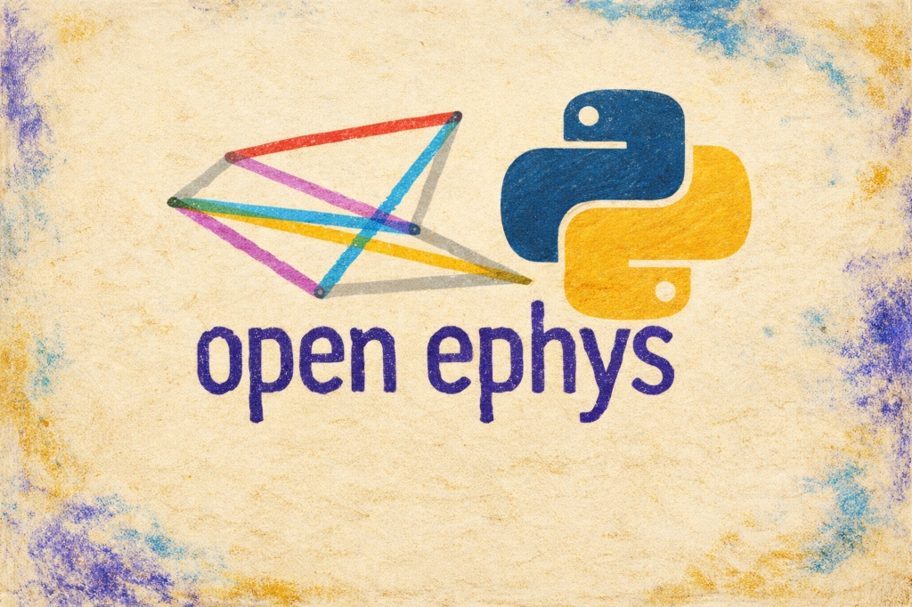

# python-open-ephys

[](https://neuro-mechatronics-interfaces.github.io/python-open-ephys/)
[](https://github.com/Neuro-Mechatronics-Interfaces/python-open-ephys/actions/workflows/test.yml)
[](https://pypi.org/project/python-oephys/)
[](https://pypi.org/project/python-oephys/)
[](https://opensource.org/licenses/MIT)

`python-open-ephys` is a Python toolkit for loading, streaming, processing,
and visualizing Open Ephys electrophysiology data. It provides file I/O,
real-time ZMQ and LSL interfaces, EMG signal-processing utilities, and
standalone examples for analysis and acquisition workflows.

## Quick links

- [Documentation](https://neuro-mechatronics-interfaces.github.io/python-open-ephys/)
- [Examples](examples/)
- [API source](src/pyoephys/)
- [Contributing guide](CONTRIBUTING.md)
- [Issue tracker](https://github.com/Neuro-Mechatronics-Interfaces/python-open-ephys/issues)

## Features

- Load Open Ephys Binary recordings and normalized NumPy exports.
- Stream data from the Open Ephys GUI over ZMQ and LSL.
- Filter, synchronize, and quality-check EMG and electrophysiology signals.
- Inspect recordings with offline and real-time viewer applications.
- Capture LSL streams to NumPy files and replay Open Ephys recordings over LSL.
- Build machine-learning workflows on top of the same session data.

## Installation

### From PyPI

```bash
python -m pip install python-oephys
```

The package supports Python 3.10 and newer.

### From source

```bash
git clone https://github.com/Neuro-Mechatronics-Interfaces/python-open-ephys.git
cd python-open-ephys
python -m pip install -e .
```

### Optional dependency groups

Install the groups explicitly when you need their tooling:

```bash
python -m pip install "python-oephys[gui]"   # PyQt5 and visualization tools
python -m pip install "python-oephys[ml]"    # PyTorch, scikit-learn, joblib
python -m pip install "python-oephys[docs]"  # Sphinx documentation tools
```

## Getting started

### Load and filter an Open Ephys recording

```python
from pyoephys.io import load_open_ephys_session
from pyoephys.processing import bandpass_filter

session = load_open_ephys_session("path/to/recording.oebin")
amplifier_data = session["amplifier_data"]
sample_rate = session["sample_rate"]

filtered = bandpass_filter(
    amplifier_data,
    lowcut=10,
    highcut=450,
    fs=sample_rate,
)
```

### Connect to a live Open Ephys stream

The real-time viewer connects to the Open Ephys ZMQ Interface plugin:

```bash
python -m pyoephys.applications._realtime_viewer \
  --host 127.0.0.1 \
  --channels 0:8
```

For programmatic interfaces, see `pyoephys.interface.ZMQClient` and
`pyoephys.interface.LSLClient` in the API documentation.

### Capture or replay LSL data

The package installs two command-line tools:

```bash
pyoephys-lsl2npz --help
pyoephys-playback --help
```

The corresponding examples and LSL utilities are in
[`examples/interface/lsl/`](examples/interface/lsl/).

## Synchronize with a digital pulse

Record in Binary format with event recording enabled. Trigger the Pico
while recording and keep its LED in the camera view. Read both polarities
from the recording's saved TTL channel:

```python
from pyoephys.io import read_digital_edges

for edge in read_digital_edges("recording1/structure.oebin"):
    if edge.line == 4:
        print(edge.stream_id, edge.source, edge.sample_number, edge.sample_rate, edge.rising)
```

Lines are one-based. Use `event_folder` with a folder name from
`structure.oebin` to select one TTL channel. Use `segment` to distinguish
recordings when merging them. Compare pulse intervals in samples divided
by the sample rate within a stream and segment, then match the sequence
of edges to the LED turning on and off.

For live synchronization, connect to the ZMQ Interface plugin and enable
timing notifications with `ZMQClient(sync_buffer_size=4096)`. After
`start()`, call `notifications, evicted = client.drain_sync()` regularly
to receive `DigitalEdge` events and `SampleSpan` metadata in packet order.
`evicted` counts notifications lost from the local queue since the last
drain. Spans report forward gaps per stream and channel when successive
packets supply sample numbers. Missing indices are counted locally and
labeled `reconstructed`. A TTL edge received before waveform metadata can
have an unknown sample rate. Its original sample number is still available.
Segments change on a client restart, a decrease in message number, a sample-rate
change, or a rewind on the stream's reference waveform channel. TTL events stay
provisional in the bounded queue until the next indexed waveform establishes
their segment. A drain returns immediately; unresolved events have `segment=None`
and `sample_rate=None`, including events from an event-only stream. At a rewind
or rate change, only queued events inside the new waveform's sample range are
assigned to its segment. Other boundary events remain unknown. Packet order is
preserved, and queue evictions include provisional events. Only compare sample
numbers when both events have a known, matching stream and segment.

The bundled LSL streaming example labels its reconstructed EMG and ADC
timestamps and its repeated IMU values in the outlet metadata. Use saved
TTL events to measure alignment to the camera LED.

## Examples

- [`examples/read_files/`](examples/read_files/) — inspect metadata and convert recordings.
- [`examples/interface/`](examples/interface/) — ZMQ, LSL, IMU, and hardware interfaces.
- [`examples/applications/`](examples/applications/) — standalone viewers and applications.
- [`examples/applications/cue_player/`](examples/applications/cue_player/) — timed LSL cue markers.
- [`examples/joint_angle_regression/`](examples/joint_angle_regression/) — standalone EMG session GUI with optional LSL reference streams.
- [`examples/analysis/`](examples/analysis/) — analysis and quality-control workflows.
- [`examples/benchmarks/`](examples/benchmarks/) — performance checks.
- [`examples/visualization/`](examples/visualization/) — offline and live visualizations.

All external integrations are optional. This repository does not require a
separate recording application or another project; examples communicate
through documented interfaces such as LSL, ZMQ, and files.

## Package structure

```text
src/pyoephys/
├── io/          Open Ephys file loading and dataset utilities
├── interface/   ZMQ, LSL, playback, and device interfaces
├── processing/  Filtering, synchronization, features, and QC
├── plotting/    Reusable plotting components
├── applications/ Viewer and command-line applications
└── ml/          Optional model and evaluation utilities
```

## Documentation

Read the full documentation at:

<https://neuro-mechatronics-interfaces.github.io/python-open-ephys/>

Build it locally with:

```bash
python -m pip install "python-oephys[docs]"
python -m sphinx -b html docs/source docs/build/html
```

## Development

Run the test suite from the repository root:

```bash
pytest tests/
```

Build source and wheel distributions:

```bash
python -m build
python -m twine check dist/*
```

The manually triggered TestPyPI workflow is defined in
[`.github/workflows/test_release.yml`](.github/workflows/test_release.yml).
Published GitHub Releases trigger the PyPI workflow.

### Release to PyPI

Versions come from Git tags through `setuptools_scm`; do not manually edit
`src/pyoephys/_version.py` or add a static version to `pyproject.toml`.
The synchronization APIs added after 0.1.3 are intended for release 0.2.0.
Use a new, unused version for every subsequent release.

After the changes are committed and pushed to `main`, verify its GitHub Actions
tests pass and the working tree is clean. From the repository root, with GitHub
CLI authenticated, run:

```bash
git switch main
git pull --ff-only origin main
git tag -a v0.2.0 -m "Release 0.2.0"
git push origin v0.2.0
gh release create v0.2.0 --verify-tag --title "v0.2.0" --generate-notes
```

Publishing that GitHub Release triggers
[`.github/workflows/publish.yml`](.github/workflows/publish.yml), which builds
the tagged source and uploads it using the repository's `PYPI_API_TOKEN` secret.
Pushing a tag alone does not publish to PyPI. Check the workflow succeeds before
installing the release:

```bash
python -m pip install --upgrade "python-oephys==0.2.0"
python -c "import pyoephys; print(pyoephys.__version__)"
```

## Contributing

Issues and pull requests are welcome. Please include the target workflow,
example data format, and any GUI or hardware assumptions so changes can be
tested cleanly. Keep cross-project integrations optional and document them as
examples rather than package requirements.

## License

This project is licensed under the MIT License. See [LICENSE](LICENSE).
